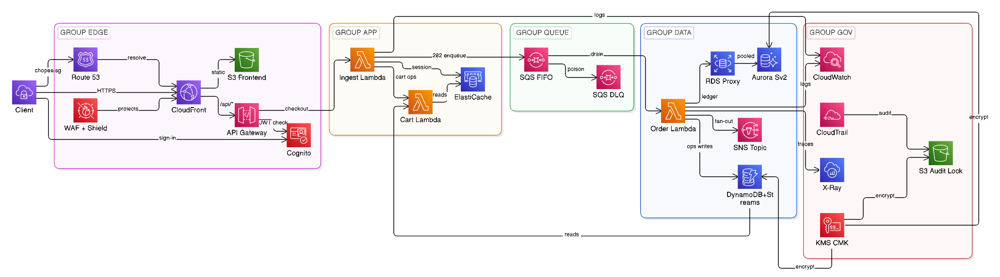
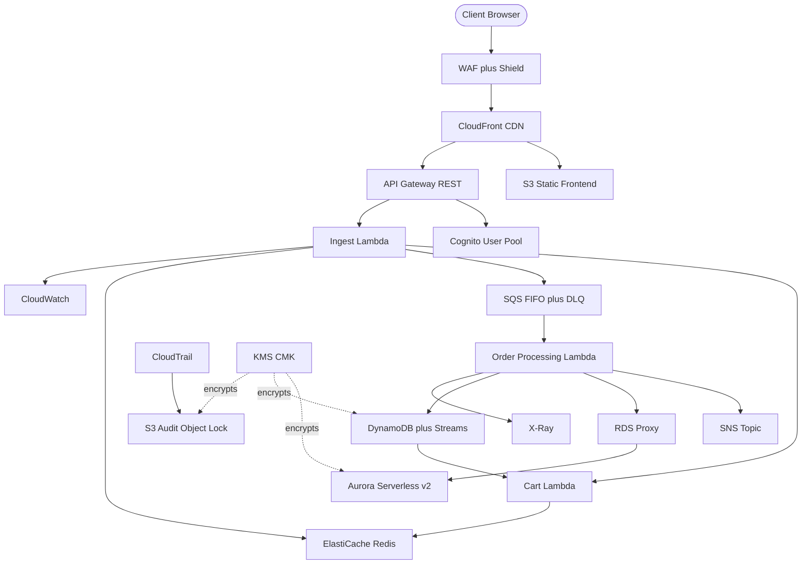

# 02 — Architecture

## System architecture (what Terraform creates)

Text equivalent of the diagram above:

## Local-first checkout flow (mirrors the deployed path)

Flow: 1) caller sends authenticated checkout; 2) API Gateway validates JWT and invokes ingest, which returns 202; 3) ingest enqueues to SQS FIFO and the processing Lambda drains the queue into the stores with telemetry. Local runs mirror this flow without cloud resources.

## Contrast and justification

- Network: keep VPC use minimal so teardown stays fast; any AWS networking is allowed if the run stays under the USD 80 cap.
- Compute: Lambda handlers per service (implementation to follow; any runtime or architecture is allowed under the cap).
- Store: persistent store for carts, orders, inventory, and idempotency (implementation to follow the specs; the USD 80 cap is the only cloud restriction).
- Delivery: manual Terraform CLI only; state in S3 plus DynamoDB lock, both in `ap-southeast-1`.

## IAM matrix per hop

- API Gateway invokes ingest Lambda only. Ingest may SendMessage to the FIFO queue and write logs and traces only. Processing Lambda may read and delete queue batches, read and conditionally write the table, publish to SNS, and write logs and traces only. No Lambda gets `*` actions. Console changes are blocked by IAM guardrail narrative.
