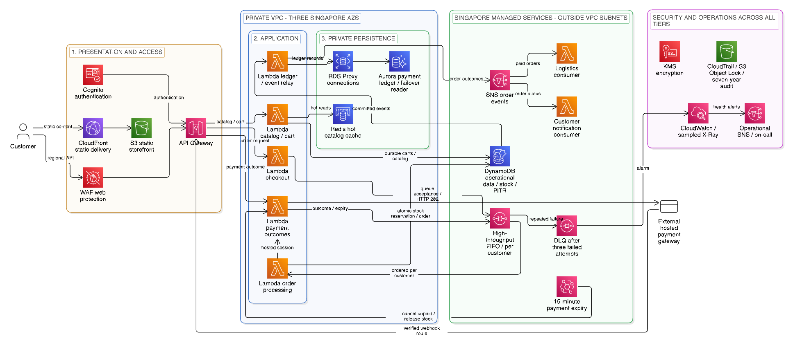

# 02 — Architecture

Aligned with the current proposal on 2026-10-14 (Eraser "Second Cut" target and demo). The [proposal](../proposal.md) is the scope authority. The full design is documented; only its explicitly bounded demo is provisioned.

### 3.1 Resource Allocation Justification & Linkages

The architecture separates presentation/ingress, application processing, and persistence into three tiers. Security and observability support all three. All regional resources and customer data remain in `ap-southeast-1`; CloudFront caches only public static assets. Dynamic API calls pass through CloudFront to the ALB without edge caching.

**Insert Figure 1 here, before the resource explanations: Full enterprise target architecture.** Private subnets and enterprise services are designed here but not provisioned for the demo.

**Edge & Ingress (Route 53, WAF, CloudFront, S3, ALB, Cognito):** CloudFront serves the storefront from a private S3 origin using Origin Access Control and routes `/api/*` to the ALB. WAF attaches to CloudFront, not to the customer, so attacks and abusive rates are filtered at the edge. WAF for CloudFront is a global service managed from `us-east-1`; it stores no customer data. The ALB accepts traffic only from CloudFront (managed prefix list plus a secret header), so WAF cannot be bypassed. Customers sign in directly with Cognito. The Fargate services check the token signature against Cognito's public keys, which they cache. The payment webhook enters through CloudFront and WAF; provider signature checks replace Cognito on that route. HTTPS is enforced on every hop.

**Compute & Private Networking (ECS Fargate, VPC, NAT, Redis):** Two stateless ECS Fargate services run in private subnets across three AZs: catalog/cart and checkout/webhook. Fargate has no 15-minute limit, so long customer sessions are safe. Cart and session state live in DynamoDB, not in the task. Scaling combines scheduled pre-scaling before a flash sale with target tracking during it, because tracking alone lags a sudden burst. Security groups restrict database/cache access, and NACLs add subnet perimeter control. NAT (one per AZ) gives controlled outbound access to the payment gateway and Cognito keys. Free S3/DynamoDB gateway endpoints and paid interface endpoints (SQS, Secrets Manager, telemetry) keep AWS traffic off NAT. Managed services stay regional, outside the subnet boundary. VPC/subnets have no usage charge; NAT and interface endpoints add cost.

ElastiCache Redis caches hot catalog items and promotions with invalidation or short expiry. Cached stock is never authoritative for checkout. Static edge caching does not replace backend caching.

**Queue Decoupling (SQS FIFO + DLQ + one worker Lambda):** The checkout service derives `MessageGroupId` from the authenticated customer identity and uses the UUID token as `MessageDeduplicationId`. It returns `202 Accepted` only after SQS confirms enqueue. Enable high-throughput FIFO with `DeduplicationScope=messageGroup` and `FifoThroughputLimit=perMessageGroupId`. Normal FIFO supports 300 non-batched API transactions/second; batching and high-throughput mode raise capacity. Singapore currently supports up to 9,000 non-batched transactions/second per action in high-throughput mode, subject to account quotas and sufficient customer groups. There is no separate activation fee; normal request charges apply.

**One queue carries three message types: order, payment outcome and expiry.** One worker Lambda handles all three by message type. This keeps each customer's order, payment and expiry in sequence, so a payment result cannot run before its stock reservation. Two queues would lose that ordering and double the DLQ and alarm setup. Cost: one poison message holds only its own customer's group until it moves to the DLQ.

Limit worker concurrency to protect the store. Visibility timeout is at least six times the worker timeout plus any batching window. Partial batch responses preserve FIFO order by stopping at the first failure and retrying failed/unprocessed messages. A FIFO DLQ isolates repeatedly failing messages with `maxReceiveCount=3`; its CloudWatch alarm pages on-call. Other customer groups continue during retries. Operators reconcile the affected order before redrive because moving it to the DLQ breaks the original sequence.

**Persistence (DynamoDB, Aurora Serverless v2, RDS Proxy):** Use each store for what it does best. DynamoDB on-demand holds fast-changing data: carts, guest carts, sessions, stock, orders and idempotency records. One `TransactWriteItems` conditionally reserves stock and writes the order, idempotency record and outbox event together. Order-history GSIs support read traffic; immediate order-status reads use the base table with strong consistency. Guest-cart expiry is enforced by the application because TTL deletion is asynchronous. A hot flash-sale item would exceed the per-partition write limit, so split its stock into sharded counters.

Aurora PostgreSQL holds slow-changing structured data: catalog, profiles and the payment ledger. A writer and failover reader span AZs; the initial range is 0.5–16 ACUs per instance. Redis absorbs most catalog reads; the reader serves cache misses. RDS Proxy pools connections from the Fargate tasks. Supported Aurora versions can pause at 0 ACUs, but storage charges remain and RDS Proxy prevents auto-pause. The demo therefore replaces this tier for cost and scope reasons, rather than claiming Aurora cannot fit within USD 80.

The checkout service verifies each payment webhook and writes the payment to the Aurora ledger, idempotent by the gateway event ID. A gateway retry cannot create a second ledger row. A DynamoDB update and an Aurora write are not one atomic transaction; reconciliation covers partial progress. In the demo, ledger entries join the DynamoDB transaction.

**Order events (DynamoDB Streams outbox relay → SNS):** A relay Lambda reads DynamoDB Streams and publishes each committed order event to SNS. The commit and the outbox record are one transaction, so a worker that fails after commit cannot lose the event. The relay retries until SNS accepts it; an `IteratorAge` alarm shows a stuck relay. Consumers use stable event IDs and ignore repeats. Simpler alternative if needed later: let the worker publish after commit and re-publish on every retry.

**Payment & Notification Linkage:** Real payment settlement is designed, not implemented. The full flow reserves inventory and records `PENDING_PAYMENT`. The checkout service creates a hosted gateway session with an order-based idempotency key, calling out through NAT. The gateway's webhook reaches the checkout service, which verifies provider signature, timestamp, event ID, amount, currency and order reference, then enqueues a payment event into the customer FIFO. EventBridge Scheduler enqueues a cancellation command into the same FIFO group 15 minutes after checkout; TTL is not the timer. Conditional state transitions prevent both success and cancellation finalizing an order and release stock once. Late payment enters refund/reconciliation handling. Gateway calls have timeouts and bounded retries. Hosted payments reduce card-data exposure without establishing PCI-DSS compliance by themselves. Schedule-creation rate is not a constraint: `CreateSchedule` defaults to 5,000 requests/second in Singapore (checked 2026-10-16), ten times the 500 orders/second target. Each schedule deletes itself after firing (`ActionAfterCompletion=DELETE`). Scheduler FIFO targets require content-based deduplication on the queue; checkout and payment messages still pass explicit deduplication IDs, which take precedence.

SNS has explicit subscriptions: a logistics Lambda consumes `OrderPaid` fulfilment events, and a customer-notification Lambda consumes order-status events. Subscription DLQs retain delivery failures. Demo consumers record synthetic fulfilment and confirmation outcomes. Operational alarms use a separate SNS topic with a confirmed on-call subscriber.

**Security, Audit & Analytics (KMS, CloudTrail, CloudWatch, Firehose, S3, Macie, Glue, Athena):** The full design uses customer-managed KMS keys on S3, DynamoDB, Aurora and SQS, plus least-privilege IAM. CloudTrail records infrastructure activity. A CloudWatch Logs subscription filter sends application logs through Firehose to the same S3 audit archive. That archive keeps seven-year Object Lock Governance retention as an internal policy. CloudWatch stays the live view for metrics, alarms and traces.

A daily report Lambda runs off-peak. It reads delivered logs from S3, not from CloudWatch, so heavy flash-sale logs cannot crash it. It masks PII and writes reports to an S3 reports bucket. For very large volumes, run Athena queries instead, because Lambda stops at 15 minutes. Glue catalogs the data; Athena and QuickSight show flash-sale dashboards. Macie only finds PII. It scans the archive and reports buckets and alerts the operational SNS topic; masking happens in the report Lambda and in log standards. The audit archive is immutable, so nothing is masked there.

Backups remain in Singapore. Availability, RTO, and RPO are design objectives, not short-demo guarantees. PITR recovery includes restoration to a new table and switching application access; Multi-AZ operation does not prove recovery from deletion or a regional outage.

## Capacity check

Basis: 10,000 req/s peak ingress; about 9,500 reads and 500 checkout writes per second (proposal Appendix C). Figures are planning estimates; confirm by load test.

| Component | Demand | Sizing / note |
|---|---|---|
| ALB | 10,000 req/s | Scales with load. Pre-warm before a flash sale; sudden steps can outrun auto-scaling. |
| Fargate | 10,000 req/s | About 200 req/s per 1 vCPU task gives 50 tasks. Plan 65 with headroom, minimum 6 across 3 AZs. Pre-scale on a schedule. |
| Redis + Aurora | 9,500 reads/s | A 90% cache hit leaves about 950 reads/s for Aurora. The reader serves cache misses. |
| SQS FIFO | 500 msg/s | Well under the 9,000/s non-batched limit. Needs 1,000+ customer groups. |
| Order worker | 500 msg/s | Batches of 10 give 50 batches/s, about 15 concurrent Lambdas at 300 ms. Reserve about 100. |
| DynamoDB | 500 orders/s | 3 items at 2 write units each is about 3,000 write units/s in total. One hot SKU takes about 1,000 write units/s, which is the per-partition limit, so shard stock in the target. The demo spreads the burst across at least 20 SKUs (about 25 orders/s each) and tests hot-item contention separately. |
| Cognito | 90,000 sign-ins in 5 min | About 300 sign-ins/s. Check the sign-in quota and request an increase. |

## Diagram creation

- Both figures are Eraser "Second Cut" diagrams. The team edited the target. The demo was derived from the target's code by removing or simplifying services. Eraser performs layout, rendering and PNG export.
- The proposal embeds Eraser-exported images from `docs/architecture/` and links to their editable canvases. See [the diagram registry](../architecture/README.md).
- No local drawing scripts, SVG generator or locally authored raster renderer is used.
- Budget reductions and validation: proposal Sections 3.2–3.3. Operational thresholds: proposal Section 5.

## Technical verification references

Official documentation checked on 2026-10-10:

- [FIFO throughput quotas](https://docs.aws.amazon.com/AWSSimpleQueueService/latest/SQSDeveloperGuide/quotas-messages.html) and [high-throughput settings](https://docs.aws.amazon.com/AWSSimpleQueueService/latest/SQSDeveloperGuide/enable-high-throughput-fifo.html).
- [Lambda SQS configuration](https://docs.aws.amazon.com/lambda/latest/dg/services-sqs-configure.html) and [FIFO partial-batch failure handling](https://docs.aws.amazon.com/lambda/latest/dg/services-sqs-errorhandling.html).
- [Aurora pause limitations, including RDS Proxy](https://docs.aws.amazon.com/AmazonRDS/latest/AuroraUserGuide/aurora-serverless-v2-auto-pause.html).
- [Free gateway endpoints](https://docs.aws.amazon.com/vpc/latest/privatelink/gateway-endpoints.html) and [paid interface endpoints](https://docs.aws.amazon.com/vpc/latest/privatelink/create-interface-endpoint.html).
- [ElastiCache pricing](https://aws.amazon.com/elasticache/pricing/) and [CloudFront pricing options](https://aws.amazon.com/cloudfront/faqs/).
- [Object Lock deletion restrictions](https://docs.aws.amazon.com/AmazonS3/latest/userguide/object-lock.html).

Checked on 2026-10-16:

- [EventBridge Scheduler quotas](https://docs.aws.amazon.com/general/latest/gr/eventbridgescheduler.html): `CreateSchedule` 5,000 requests/second in `ap-southeast-1`, adjustable.
- [Scheduler `SqsParameters`](https://docs.aws.amazon.com/scheduler/latest/APIReference/API_SqsParameters.html): FIFO targets take a `MessageGroupId` and require content-based deduplication on the queue.
- [Lambda quotas](https://docs.aws.amazon.com/lambda/latest/dg/gettingstarted-limits.html): 1,000 concurrent executions by default, but new accounts start lower, so request an increase before the load run.

These verify service behaviour, not an account-specific price quote or measured demo outcome. Not yet checked against AWS documentation: ALB restriction to CloudFront, Fargate scaling and pricing, Firehose log delivery, Macie behaviour, Cognito sign-in quotas and the per-task request rate. Recheck these, quotas and the planned Singapore cost estimate before apply.

## Demo scope

Retain CloudFront/S3, an ALB with two Fargate services, one FIFO/DLQ with one worker Lambda, the outbox relay, two SNS consumers, essential CloudWatch alarms, sampled X-Ray, one scheduled report to S3 and PITR. Enterprise-only: WAF, Route 53, Aurora/Proxy, Redis, private subnets/NAT, dedicated keys, Macie, Firehose, Glue/Athena/QuickSight and the protected seven-year archive. The demo VPC has two AZs and public subnets with public task IPs (no NAT); Fargate security groups allow only the ALB. The ALB security group allows only CloudFront's origin-facing managed prefix list and the operator's `/32`, and `/api/*` rules require a secret origin header that CloudFront adds. Without a custom domain, CloudFront → ALB is HTTP; HTTPS on every hop is a target-design property. The simulated payment gateway (a script on the operator's machine) calls the ALB webhook directly, as a real gateway would be IP-allow-listed; HMAC signature verification protects it. ECS deployment circuit breakers with rollback are enabled on both services. Build detail: [plan 06](06-demo-build.md). Use the [demo export](../architecture/demo_architecture.png) and [target export](../architecture/target_architecture.png) as the canonical figures. Eraser remains the diagram editor.

## Validation boundaries

The three tiers, Terraform lifecycle, request-to-notification trace, failure alarms, resource-reduction table and cost record provide evidence for the seven evaluation criteria. The six roles in Section 6 own the work.

**Phase 4 includes a checkout-only test of 500 orders/second for 60 seconds after warm-up**, ramped gradually across at least 1,000 authenticated customer groups with unique tokens and sufficient stock. Pre-scale Fargate before the burst. Record offered/accepted rates, p95/p99 acknowledgement latency, 429/5xx rates, queue age, terminal completion and drain time. Acceptance targets are 500 accepted orders/sec during the burst, p95 acknowledgement ≤200 ms, no unexplained loss/duplicate commits/oversells, and drain within five minutes afterward. Report missed targets openly; duplicates and hot-item contention use separate tests.

For sizing, interpret the 10,000 req/sec peak as total ingress, with Appendix C's read/write approximation yielding 500 checkout writes/sec. The demo does not prove 10,000 checkouts/sec, 1.5 million users, continuous 99.9% availability, or enterprise failover targets. A `202` proves queue acceptance, not completed payment; a later stock failure is reported through order status/events. Real settlement, private networking, Aurora reconciliation, production CDN performance and Multi-AZ failover exercises remain design-only. The demo includes functional CloudFront/S3 delivery.

### Demo cost assumptions

Singapore, USD before tax; 5 hours/session, 4 sessions/month, full teardown. One 60-second 500-orders/sec burst (30,000 orders), 60,000 ALB requests, 1,000 Cognito Lite users per recreated pool, 4 Fargate tasks at baseline (2 per service, 2 AZs) scaling to about 8 for the burst, 150,000 ARM64 Lambda calls at 256 MB/200 ms, 600,000 DynamoDB write units (including transactional amplification), 60,000 read units, 120,000 FIFO calls, 30,000 SNS publications, <=1 GB static transfer and bounded telemetry. No free allowances or credits assumed in the base estimate. Approximate transaction subtotal USD 1; allow USD 1–3 for telemetry/storage/transfer, USD 5.50 for Cognito and USD 1–2 for the ALB and Fargate tasks, round to USD 8–12/session. These are modeled quantities, not measurements. Confirm actual request amplification, task counts and duration before apply.

WAF example: one ACL + three basic rules, 60,000 inspected requests: (USD 8/730)*5 + USD 0.60*0.06 = USD 0.091/session. Redis example: 2 cache.t4g.micro nodes * USD 0.024 * 5h = USD 0.24. Aurora minimum compute example: writer + reader, 0.5 ACU each * USD 0.20 * 5h = USD 1; excludes proxy/storage/I/O and scaling. These small configurations do not prove 500-orders/sec capacity. The ALB/Fargate range is a planning allowance; the per-unit rates are not yet verified.

Rates checked 2026-10-10: [WAF](https://aws.amazon.com/waf/pricing/), [Cognito](https://aws.amazon.com/cognito/pricing/), [Lambda](https://aws.amazon.com/lambda/pricing/), [Singapore DynamoDB catalog](https://pricing.us-east-1.amazonaws.com/offers/v1.0/aws/AmazonDynamoDB/current/ap-southeast-1/index.json), [Singapore ElastiCache catalog](https://pricing.us-east-1.amazonaws.com/offers/v1.0/aws/AmazonElastiCache/current/ap-southeast-1/index.json), [Singapore RDS catalog](https://pricing.us-east-1.amazonaws.com/offers/v1.0/aws/AmazonRDS/current/ap-southeast-1/index.json).
