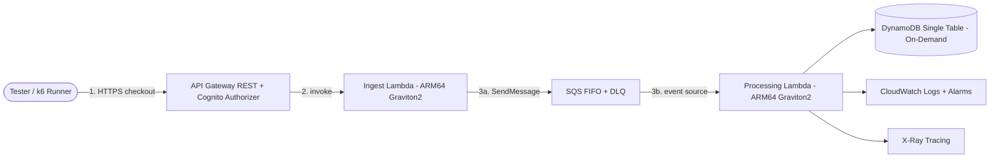

# ChopeE Proposal

**Path:** `docs/proposal.md`
**Date:** 2026-09-24 (revised)
**Status:** Approved for implementation
**Project:** ChopeE — Online Shopping System (Singapore + ASEAN)
**Region:** `ap-southeast-1` (Singapore) only. No multi-region deployment.

**Goal:** Define the architecture, documentation system, and setup for ChopeE as a single serverless stack within a total budget limit of USD 80 for active test runs only. Everything is treated as the stack — there is no separate naming for environments.

> **Ephemeral Testing Lifecycle (binding):** The stack is strictly EPHEMERAL — spun up for at most five hours during active testing or evaluation, then immediately torn down via `terraform destroy -auto-approve`. The USD 80 budget covers active test runs only (pay-per-request charges incurred while the stack exists); there is deliberately zero idle burn between runs because nothing remains deployed.

**Architecture:** Single serverless stack (API Gateway + SQS FIFO + Lambda ARM64 + DynamoDB on-demand single table + VPC Gateway Endpoints) provisioned via manual Terraform CLI only.

**Tech Stack:** Terraform (CLI only, no CI/CD), API Gateway REST, SQS FIFO + DLQ, Lambda ARM64 Graviton2 (Python 3.12), DynamoDB on-demand, CloudWatch + X-Ray, Cognito User Pool, S3 (frontend/audit), KMS CMK.

## Global Constraints

- Total cloud spend strictly ≤ USD 80 for active test runs only (hard cap). No idle spend: the stack exists only for hours at a time.
- The stack is strictly EPHEMERAL: spun up for at most five hours during testing or evaluation, then immediately torn down via `terraform destroy -auto-approve`. Fast-teardown guarantees: S3 buckets must have `force_destroy = true` in tfvars to prevent `BucketNotEmpty` errors; no ENI-hanging dependencies (Lambdas outside VPC by default, so no ENI cleanup delay); zero hourly-billed services (NO NAT Gateway, NO Aurora, NO ElastiCache Redis cluster) to ensure zero budget leakage between runs.
- 100% data residency in `ap-southeast-1`; AES-256 at rest (KMS CMK where free-tier viable), TLS 1.3 in transit; PDPA-aligned consent + 7-year audit retention.
- Flash-sale target: 1500 TPS absorb, p95 < 1.5s for checkout mutations (design target; validates at reduced synthetic load during timed runs).
- Manual `terraform plan` / `terraform apply` from operator workstation only — no GitHub Actions / no CI/CD pipelines.
- Zero-idle-cost serverless only — no NAT Gateway (~$32+/mo each), no Aurora, no ElastiCache, no always-on endpoints.
- Proposal here in `docs/proposal.md`; area plans live in `docs/plans/` (01–05). No binaries under `docs/`.

---

## 1. Business Context & Strategic Goals

### 1.1 Operating context

ChopeE is an omnichannel online shopping system headquartered in Singapore, serving urban consumers aged 18–45. Traffic is flash-sale driven (9.9, 11.11, payday sales).

- **Geography:** Singapore 80% + ASEAN 20% (MY/TH/HK spillover). All serving and storage stays in `ap-southeast-1`; ASEAN users are served cross-border from Singapore — no data replication outside the region.
- **Boundary:** Customer identity (Cognito), catalog discovery, cart lifecycle, order processing, compliance logging. Out of scope (tokenized interfaces only): payment gateway settlement, logistics fulfilment.
- **Peak profile:** Bursty checkout writes, hot catalog reads, anonymous browsing → authenticated purchase conversion.

### 1.2 Three strategic goals (design drivers)

| # | Goal | Measurable target | Design consequence |
|---|------|-------------------|--------------------|
| G1 | Elastic flash-sale throughput | Absorb 1500 TPS bursts; p95 < 1.5s on checkout mutations; zero dropped valid requests | Async ingest (202 on enqueue), SQS FIFO buffering per-customer ordering, controlled-concurrency downstream workers, conditional inventory writes |
| G2 | Consumer data sovereignty & PDPA compliance | 100% data in `ap-southeast-1`; AES-256 at rest; explicit consent tracking; immutable 7-year audit trail | KMS envelope encryption, Cognito consent attributes, CloudTrail → S3 Object Lock (Governance Mode) audit bucket, no cross-region copies |
| G3 | Capital efficiency & serverless economics, ≤ USD 80 total | Zero idle cost; pay-per-request only | DynamoDB on-demand, Lambda ARM64 Graviton2 (~20% cheaper), SQS FIFO, API Gateway; exclude NAT Gateway / Aurora / ElastiCache; manual Terraform CLI to avoid pipeline-runner costs |

G3 is a hard constraint, not an aspiration: any resource with hourly charge is excluded from the stack.

---

## 2. Architecture & Service Boundaries

### 2.1 System architecture (what Terraform creates)

Flow: 1) tester/k6 sends authenticated checkout requests; 2) API Gateway validates Cognito JWT and invokes Ingest Lambda, which returns `202 ACCEPTED`; 3) Ingest enqueues to SQS FIFO, Processing Lambda drains the queue and commits to DynamoDB, emitting CloudWatch/X-Ray telemetry.

Explicitly excluded: NAT Gateway (each ~$32/mo — would consume the USD 80 budget alone), Aurora Serverless v2 + RDS Proxy, ElastiCache Redis, CloudFront/WAF continuous use, cross-region replication, provisioned throughput.

### 2.2 Resource rationale

| Dimension | Choice (Terraform) | Rationale |
|-----------|--------------------|-----------|
| Network | No VPC or minimal VPC + Gateway Endpoints only; never NAT Gateway | Gateway Endpoints are free; NAT Gateways are hourly-billed |
| Ingest | API Gateway REST + Cognito JWT | JWT-validated ingest only; no edge stack needed for timed runs |
| Buffering | SQS FIFO + DLQ | FIFO + dedup is the cheapest elasticity story |
| Compute | Lambda ARM64 Graviton2, Python 3.12, reserved concurrency | ~20% cheaper per ms |
| Store | DynamoDB on-demand **single table** (`pk`/`sk` + 1–2 GSIs, TTL on guest carts) | One table = minimal RCU/WCU sprawl, simplest IaC |
| Ledger | DynamoDB TransactWriteItems ledger entries | Aurora idle/min-ACU cost breaks USD 80; DynamoDB pay-per-write does not |
| Cache | None (TTL + short API-GW caching) | Redis hourly cost excluded |
| Observability | CloudWatch + X-Ray + CloudTrail → S3 Object Lock | All pay-per-ingest, near-free at test volume |
| Data protection | KMS AWS-managed default + CMK only where free; consent attributes in table | Same PDPA posture, no CMK monthly fees |
| Delivery | **Manual Terraform CLI only** (`terraform init/plan/apply/destroy`); S3 + DynamoDB remote state/lock | No runner minutes, no pipeline secrets, full audit via state + plan files |

### 2.3 Service boundaries

1. **Identity (Cognito):** signup/signin, JWT, consent-timestamp custom attributes. No custom auth code.
2. **Ingest (API GW + Ingest Lambda):** validate schema, require `Idempotency-Key: <uuidv4>`, `PutMessage` to SQS FIFO, return `202 {orderId, status: ACCEPTED}` in < 200 ms. Never touches inventory synchronously.
3. **Buffer (SQS FIFO + DLQ):** `MessageGroupId = customerId`, content-based dedup on idempotency key, `VisibilityTimeout` ≥ 6× Lambda timeout, DLQ `maxReceiveCount=3` + CloudWatch alarm.
4. **Process (Processing Lambda):** batch source mapping, DynamoDB conditional decrement (`stock >= qty`), `TransactWriteItems` for cart-merge/order-commit, idempotency guard (`attribute_not_exists(idemKey)`), SNS fan-out on success.
5. **Store (DynamoDB single table):** entity prefixes (`USER#`, `CART#`, `GUEST#`, `INV#`, `ORDER#`, `IDEM#`, `CONSENT#`), TTL on `GUEST#` (24 h), GSI on order-by-customer, PITR enabled.
6. **Observe (CloudWatch/X-Ray):** structured JSON logs with `traceId/orderId/idemKey`, alarms on 5xx > 2%/5min, `ApproximateAgeOfOldestMessage` > 60 s, Lambda errors/throttles, DynamoDB throttles.

### 2.4 Manual Terraform CLI execution (no CI/CD)

- Operator runs `terraform fmt -check`, `terraform init`, `terraform validate`, `terraform plan -out=tfplan`, `terraform apply tfplan`, `terraform destroy` from an allowlisted IAM role. State in S3 + DynamoDB lock table, both in `ap-southeast-1`.
- Repo layout: `infra/terraform/{versions.tf,variables.tf,main.tf,modules/{api,queues,compute,database,observe}/,envs/live.tfvars}`. No `.github/workflows/` for infra — automation absence is a cost control, not a gap.

---

## 3. Professor Requirements Alignment (7 criteria)

Map every criterion to a concrete artifact. No criterion without evidence.

| # | Criterion | What is expected | ChopeE evidence | Artifact |
|---|-----------|------------------|-----------------|----------|
| 1 | Feasibility | Scope fits time/budget/skills; risks named | Flash-sale scope cut to 5 bounded contexts; USD 80 cap enforced by zero-idle-cost + manual CLI; 6-role split; risks (cold start, SQS poison, oversell) with mitigations | `docs/plans/01-scope-feasibility.md` |
| 2 | Resource Justification | Each resource earns its place on cost/performance | Per-resource rationale table (Section 2.2); ARM64 %, on-demand vs provisioned, Gateway Endpoint vs NAT math | `docs/plans/02-architecture.md` § justification |
| 3 | Resource Linkage | Resources connect into a coherent flow | Ingest→buffer→process→store→notify trace with IAM least-privilege per hop; JWT→FIFO-group→conditional-write→SNS chain | `docs/plans/02-architecture.md` diagrams + IAM matrix |
| 4 | Design & Implementation | IaC actually provisions; code runs end-to-end | Modular Terraform + Lambda handlers + single-table schema; `plan/apply/destroy` reproducible | `infra/terraform/` + `services/` + `docs/plans/03-*` |
| 5 | Monitoring & Alerts | Health visible; thresholds actionable | 4 alarms (5xx, queue age, Lambda errors/throttles, DB throttles) + X-Ray trace + structured logs + SNS to on-call | `docs/plans/04-operations.md` + `infra/terraform/modules/observe/` |
| 6 | Scalability & Availability | Burst + failure handled | SQS absorbs 1500 TPS design target; reserved concurrency; FIFO per-customer order; DLQ; Multi-AZ managed services; conditional-write no-oversell | `docs/plans/02-architecture.md` |
| 7 | Management Approach | Roles, phases, cadence, budget control | 6 roles (architect, DevOps/IaC, security, backend, data, SRE), 5 phases, budget guardrail under USD 80 cap, manual-apply gate | `docs/plans/05-management.md` |

---

## 4. Documentation System

- `AGENTS.md` — root operating contract: stack, region, budget cap, manual-Terraform-only rule, doc locations, Definition of Done, forbidden patterns.
- `docs/proposal.md` — this proposal (overall direction and constraints).
- `docs/plans/` — area plans (numbered 01–05, see below).

Plans:

- `docs/plans/01-scope-feasibility.md` — scope, geography, goals G1–G3, feasibility, risks.
- `docs/plans/02-architecture.md` — architecture, diagrams, IAM matrix, store design.
- `docs/plans/03-data-cart-orders.md` — cart migration, idempotency, inventory transactions, key design.
- `docs/plans/04-operations.md` — alarms, logs, X-Ray, budgets, runbooks.
- `docs/plans/05-management.md` — roles, 5 phases, cadence, budget governance.

Doc hygiene:

- Proposal sets direction; plans carry the detail — overall flow plus the nitty-gritty per area.
- Every diagram as text (Mermaid) so diffs review cleanly.
- Every cost claim names the pricing lever (ARM64, on-demand, no NAT) and the cap (USD 80).

---

## 5. Validation Plan

Local-first validation with zero cloud spend:

1. **SQS decoupling & idempotency:** FIFO buffering + idempotency key survives burst + duplicate delivery — exactly-one order commit, `202` in < 200 ms, DLQ receives only poison messages.
2. **Anonymous-to-authenticated cart migration:** guest→user merge loses nothing under race — merged quantities equal sum, pricing refreshed, guest key deleted, TTL honored.
3. **Inventory conditional decrements:** `stock >= qty` holds with concurrent buyers — final `stock >= 0`, successful commits ≤ initial stock, losers get clean `409 CONFLICT`.

Each validation: local-first, then timed runs (max 5h each) with `destroy` after each run.

---

## 6. Setup Roadmap (what happens next, in order)

1. **Bootstrap workflow:** create `AGENTS.md`, `docs/proposal.md`, `docs/plans/`; commit.
2. **Write plans:** write `docs/plans/01–05` per professor requirements; verify zero binaries under `docs/`; commit.
3. **Terraform skeleton:** `infra/terraform/` modules per Section 2.3 + `envs/live.tfvars` (region `ap-southeast-1`, ARM64, on-demand); `init/validate/plan` green with no apply yet; commit.
4. **Services:** Lambda handlers per `docs/plans/03-*`; local validation green; commit.
5. **Harden:** alarms, budget guardrail, runbooks; final `apply` rehearsal + `destroy`; commit.

Total cloud cost across all steps must remain a small fraction of the USD 80 cap — if any step threatens it, cut scope, never raise the cap.

---

## Appendix A — Budget Guardrails (USD 80 hard cap)

- Budget guardrail under the USD 80 cap; owner stops work on breach.
- Billing levers: on-demand only, ARM64 Lambdas, Gateway Endpoints (free) instead of NAT, S3 lifecycle off buckets, PITR only on the single table, X-Ray sampling at test rate.
- Forbidden (cost): NAT Gateway, Aurora/RDS Proxy, ElastiCache, CloudFront continuous use, cross-region replication, provisioned concurrency at scale.

## Appendix B — Explicit Non-Goals

- No CI/CD pipelines for infra (manual CLI only). No multi-region deployment. No payment/logistics integration beyond tokenized stubs.
