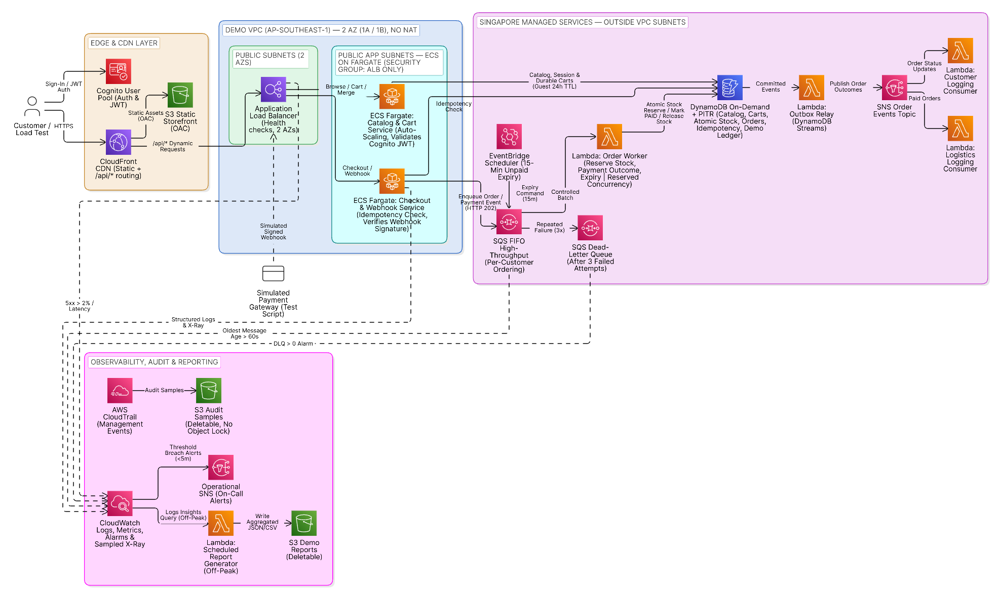

# ChopeE: Cloud-Native E-Commerce Platform Architecture Proposal

## 1. Business Context & Strategic Goals

ChopeE operates as an orange e-commerce platform headquartered in Singapore, catering to urban consumers aged 18 to 45 across APAC region with 1.5 million MAU. 80% of active shoppers reside in Singapore, while the remaining 20% are split evenly across Malaysia (6.67%), Thailand (6.67%), and Hong Kong (6.67%).

The platform experiences standard retail workloads throughout the year, but faces hyper-intense, time-limited traffic bursts during major regional shopping festivals (e.g., 9.9, 11.11, 12.12). During these peak events, concurrent checkout traffic surges up to 10,000 req/sec.

Operating traditional always-on infrastructure incurs massive idle costs as servers are overprovisioned, while underprovisioning causes platform crashes, inventory overselling, and lost customer trust. To resolve this, ChopeE adopts a cloud-native, serverless-first architecture governed by three core strategic goals:

- **Resilient performance and rapid recovery:** Protect revenue and customer trust by maintaining 99.9% checkout availability during flash-sale traffic, and recover quickly after infrastructure failures within the defined RTO while meeting the RPO targets for data loss.
- **Consumer Data Sovereignty and PDPA Compliance:** Keep customer data resident in Singapore and auditable, to meet PDPA obligations as a Singapore-registered platform.
- **Capital Efficiency via Serverless Economics:** Maximize operating margins by aligning infrastructure spend directly with real-time transaction volume

## 2. Core Use Cases & System Boundaries

### 2.1 System Boundaries & External Interfaces

The ChopeE platform boundary includes identity management, catalog discovery, shopping carts, order orchestration, and audit logging. External interfaces include:

- **Third-Party Payment Gateways:** Hosted sessions (Credit Cards, PayNow, FPX, PromptPay, FPS) using verified webhooks to keep PCI-DSS scope out of system boundaries.
- **Logistics Aggregators:** Event streams (Amazon SNS) sending fulfillment tasks to regional carriers upon payment confirmation.

### 2.2 Core Use Cases

- **Idempotent Checkout and Queue Decoupling:** The checkout service behind the ALB receives order payloads with UUID v4 tokens, validates requests, enqueues them into Amazon SQS FIFO, and returns an HTTP 202 Accepted response within 200 ms.
- **Atomic Inventory Reservation:** A downstream Lambda worker processes SQS messages in batches and reserves inventory via conditional writes in DynamoDB (Stock>=requested_quantity).
- **Tokenized Payment Processing Design:** The worker marks reserved orders PENDING_PAYMENT, and the checkout service creates the hosted payment session. The checkout service verifies each webhook and records the payment in the Aurora PostgreSQL ledger. The worker then sets PAID, and Amazon SNS notifies logistics. On failure or a 15-minute timeout, stock is released and the order is cancelled.

## 3. Enterprise Target Cloud Architecture & Resource Allocation

### 3.1 Resource Allocation Justification & Linkages

Three tiers separate presentation, application processing and persistence. Regional resources and customer data stay in Singapore; CloudFront caches public static assets only.

**Insert Figure 1 here: Enterprise target architecture, before the resource explanations.**

[Edit Figure 1 in Eraser](https://app.eraser.io/workspace/KOkL8luPYtTwgLwByHjm?diagram=-IuP_kxw8phVSPXFq48JW&layout=canvas).

- **Presentation & Access — Route 53, WAF, CloudFront, S3, Cognito, ALB:** CloudFront delivers the static storefront and routes `/api/*` to the ALB. WAF is attached to CloudFront, so web attacks are filtered before they reach the VPC. The ALB accepts traffic only from CloudFront. Customers sign in with Cognito, and the services check the token.
- **Application & Caching — ECS Fargate, private VPC, Redis:** Two Fargate services (catalog/cart and checkout/webhook) have no 15-minute limit and scale with demand. Private subnets across three AZs isolate compute and databases; NAT gives controlled outbound access. Redis accelerates hot catalog reads; DynamoDB retains durable carts and authoritative stock.
- **Order Processing — SQS FIFO, DLQ, worker Lambda:** High-throughput FIFO absorbs checkout bursts. One queue carries order, payment and expiry messages, so each customer's sequence holds. One worker Lambda handles all three. Requests receive HTTP 202 after queue acceptance. Repeatedly failing messages move to a DLQ after three failed processing attempts, triggering a CloudWatch alarm.
- **Persistence — DynamoDB, Aurora Serverless v2, RDS Proxy:** DynamoDB stores fast-changing data (carts, sessions, stock, orders) and atomically reserves stock to prevent overselling. Aurora stores slow-changing structured data: catalog, profiles and the payment ledger. RDS Proxy manages connections during traffic surges.
- **Payments & Notifications:** Hosted payments and verified webhooks are designed; live settlement is outside demo scope. Unpaid orders cancel after 15 minutes and release stock. SNS connects paid orders to a logistics consumer and order-status events to a customer-notification consumer. An outbox relay reads DynamoDB Streams and publishes each committed order event to SNS. If a worker fails after it commits, the event is still sent.
- **Security & Operations — KMS, CloudWatch, X-Ray, CloudTrail, Macie:** Encryption and least-privilege access protect data. Metrics, traces and audit records support incident response. Macie scans for PII.
- **Audit & Analytics — Firehose, S3 Object Lock, Glue, Athena, QuickSight:** CloudTrail and application logs reach a seven-year S3 archive (an internal enterprise policy). A daily report Lambda reads those logs from S3, masks PII and writes reports. Athena and QuickSight show flash-sale dashboards.

### 3.2 Live Demo Scope & Cost Reductions

The demo retains CloudFront/S3 storefront delivery, authentication, an ALB with two Fargate services, catalog/cart access, guest-cart merge, idempotent checkout, FIFO/DLQ, atomic stock reservation, simulated payment success/decline/expiry and both notification consumers. CloudWatch, sampled X-Ray, DynamoDB PITR and one scheduled report to S3 support operational evidence. Enterprise services are simplified as follows.

**Insert Figure 2 here: Demo architecture, before the scope comparison.**

[Edit Figure 2 in Eraser](https://app.eraser.io/workspace/KOkL8luPYtTwgLwByHjm?diagram=tBO0dUp-xK1KAJ8gYvZB&layout=canvas).

| Enterprise capability | Demo choice | Reason / boundary |
|---|---|---|
| Aurora + RDS Proxy | DynamoDB ledger records | Avoid a second database and its compute, proxy and storage charges; relational reporting and settlement reconciliation remain design-only. |
| Redis | 30-second in-process catalog cache in the catalog/cart service, DynamoDB behind it | Avoid cache nodes and configuration; shared cache performance and invalidation remain design-only. |
| Private subnets, NAT, endpoints, three AZs | Two-AZ VPC, Fargate in public subnets, security group open to the ALB only | Avoid paid NAT/interface endpoints. Private subnet isolation and the third AZ remain design-only. |
| Route 53 + WAF + ACM on the ALB | CloudFront default domain and certificate; ALB reachable only from CloudFront's origin-facing prefix list (plus a secret origin header) and the operator's IP for the simulated gateway; JWT and webhook signature checks | WAF for CloudFront is global (`us-east-1`), so the demo omits it to keep every resource in Singapore. Without a custom domain the CloudFront → ALB hop is HTTP; HTTPS end to end and web-attack filtering remain design-only. |
| Sharded stock counters for hot items | One stock item per SKU; the burst spreads across at least 20 SKUs and hot-item contention is tested separately at low volume | Correctness (no overselling) is demonstrated; single-SKU throughput above the per-partition limit remains design-only. |
| Dedicated KMS keys, Macie, Firehose, Glue/Athena/QuickSight, protected audit archive | Service-supported encryption, one scheduled report Lambda to S3, deletable audit samples | Retain encryption, one report and audit evidence; PII scanning, log analytics and seven-year retention remain design-only. |
| External payment and carrier integrations | Simulated payment events and logging subscribers | Demonstrate order outcomes and notifications without live settlement, bookings or paid SMS. |
| Remote Terraform state, console-blocking IAM guardrails | Local state, manual plan/apply/destroy by a named operator | One operator per run; remote state and guardrails remain the enterprise governance design. |

**Reuse over rebuild.** The course allows adapting open-source code, so the demo reuses rather than builds a shop. The storefront screens, guest-cart identifiers and cart-merge-on-login logic are ported from AWS's MIT-0 [serverless shopping cart sample](https://github.com/aws-samples/aws-serverless-shopping-cart), which already uses Python, Cognito and DynamoDB. Powertools for AWS Lambda supplies structured logging, metrics, tracing and FIFO partial-batch handling; k6 generates load. Full commerce platforms (Saleor, Medusa, Magento and similar) were rejected because they bring their own relational database, cache and order pipeline, which would replace the very flows this project is assessed on. Custom code is limited to checkout, the order worker, payment state, the outbox relay, notification consumers and the report. The build specification is [plan 06](plans/06-demo-build.md).

**Estimated demo cost:** USD 8–12 for one session; USD 32–48 for four sessions per month. Each session lasts at most five hours, includes one 60-second burst at 500 orders/second (30,000 orders), approximately 60,000 API requests and 1,000 test users, then full teardown. Estimates include bounded telemetry and modest storefront traffic, exclude tax, and assume no free allowances or credits. They are planning estimates, not measured bills. They assume the Cognito Lite tier; the default Essentials tier would nearly triple the Cognito share, so the user pool sets the tier explicitly.

| Example resource cost avoided | One five-hour session | Four sessions/month |
|---|---:|---:|
| WAF: one ACL, three basic rules, 60,000 requests | ~$0.09 | ~$0.36 |
| Redis: two small cache nodes | ~$0.24 | ~$0.96 |
| Aurora: writer + reader at 0.5 ACU each, compute only | ~$1.00 | ~$4.00 |

Aurora savings exclude proxy, storage/I/O and scaling. Small-node/minimum-capacity examples do not establish peak performance. WAF and Redis reductions primarily simplify the demo. [AWS WAF pricing](https://aws.amazon.com/waf/pricing/); other regional rates and calculation assumptions are recorded in the [architecture notes](plans/02-architecture.md#demo-cost-assumptions).

The **USD 80 cap covers all project runs**, not each month. Budget USD 60 for runs and reserve USD 20 for contingency. Destroy all demo resources and verify empty state after every session; use local Terraform state and deletable audit storage. Apply and teardown remain manual.

### 3.3 Validation Scope

Phase 4 targets **500 accepted checkout orders/second for 60 seconds**, p95 acknowledgement within 200 ms (ALB target response time, with client-side k6 latency reported alongside), no duplicate orders or overselling, and queue drain within five minutes. The burst uses 1,000 test users and spreads across at least 20 SKUs; a separate low-volume test makes more buyers compete for a 50-unit item than it holds. Fargate is pre-scaled before the burst. The sizing basis is the capacity table in [plan 02](plans/02-architecture.md#capacity-check). Demonstrate payment expiry, both notification consumers and a received DLQ alarm. This validates a bounded checkout workload; enterprise availability, recovery and production-scale capacity remain design objectives.

### 3.4 Data Lifecycle & Retention

| Tier | Data | Enterprise retention | Demo |
|---|---|---|---|
| Edge / hot cache | Static storefront assets; hot catalog items | CloudFront cache; Redis with short expiry | CloudFront cache; 30-second in-process catalog cache |
| Operational | Carts, stock, orders, idempotency, outbox events | DynamoDB: guest carts 24 h, signed-in carts 30 days, outbox and consumer-dedupe records 1 day (TTL), orders kept for the customer relationship; PITR 35 days | Same rules; table deleted at teardown |
| Relational | Catalog, profiles, payment ledger | Aurora with automated backups (7 days) and snapshots before releases | DynamoDB ledger items; deleted at teardown |
| Logs and metrics | Application, ALB, Lambda logs; metrics; traces | CloudWatch 30 days for live operations, then the S3 archive | CloudWatch Logs 1 day |
| Archive | CloudTrail and application audit logs | S3 with Object Lock (Governance), seven years, transition to Glacier Deep Archive after 90 days | Deletable audit bucket, removed at teardown |
| Reports | Masked aggregates | S3 reports bucket, one year | Deletable reports bucket |

## 4. Disaster Recovery & Resiliency Strategy

The platform enforces Multi-AZ redundancy across three Availability Zones (ap-southeast-1a, 1b, 1c). Failure is contained rather than propagated: the FIFO queue absorbs bursts, the DLQ isolates poison messages to one customer's group, gateway calls use timeouts with a circuit breaker so a slow provider cannot exhaust checkout capacity, and ECS deployment circuit breakers roll back a failing release automatically.

| Metric / Objective | Target SLA | Implementation Strategy |
|---|---|---|
| Recovery Point Objective (RPO) | ≤ 5 minutes | Continuous DynamoDB Point-in-Time Recovery (PITR); synchronous Multi-AZ storage mirroring and automated Aurora write-ahead log replication. |
| Recovery Time Objective (RTO) | ≤ 15 minutes | Multi-AZ Automated Failover within ap-southeast-1; Aurora Serverless v2 automated Multi-AZ Writer/Reader failover (< 60s), ALB/Fargate cross-AZ routing, and SQS queue buffering across 3 AZ. |
| Stateless Regional Redundancy | Cold-Boot / On-Demand | Stateless IaC recovery: Terraform templates and Lambda deployment packages are retained in the repository and, for the enterprise design, in ap-southeast-1 (Singapore). No cross-region mirroring or deployment. |

**Demo evidence.** The demo runs the ALB and Fargate across two AZs, stops a checkout task during the load burst to show replacement without failed acknowledgements beyond retries, enables DynamoDB PITR, and isolates a poison message in the DLQ while other customers' orders continue. It does not prove AZ failover, Aurora failover or the RTO/RPO targets; those remain design objectives backed by the managed-service mechanisms above.

## 5. Monitoring, Alerting & Observability Operations

CloudWatch tracks service health and order outcomes; a dedicated SNS topic alerts a confirmed on-call subscriber, separate from customer and logistics notifications.

| Area | Alert / operational purpose |
|---|---|
| Ingress | Alert when ALB 5xx errors exceed 2% over five minutes; track checkout latency against the 200 ms target. |
| Compute & queues | Monitor Fargate CPU, memory and task count and Lambda errors/throttles; alert when the oldest queued order exceeds 60 seconds. |
| Failed orders | Alert whenever the order DLQ contains a message; inspect and reconcile before replay. |
| Persistence | Track DynamoDB throttling; enterprise monitoring also covers Aurora capacity and RDS Proxy connection pressure. |
| Notifications | Monitor delivery failures so logistics and customer updates are not silently lost. |
| Cost | AWS Budget alerts at 50%, 80% and 100% of the USD 80 project cap (demo); per-service cost anomaly detection (enterprise). |

**Operational KPIs.** Mean time to detect (MTTD) ≤ 5 minutes from sustained breach to alert receipt; mean time to restore (MTTR) ≤ 15 minutes, matching the RTO; checkout availability 99.9% monthly; p95 checkout acknowledgement ≤ 200 ms. The demo measures MTTD from alarm and email timestamps.

Structured logs and sampled X-Ray traces correlate checkout, stock reservation, payment outcomes and notifications without recording sensitive payloads. CloudTrail records infrastructure changes. Target alert delivery within five minutes of sustained breaches; demonstrate failure detection, notification receipt and recovery during rehearsal. Short-lived demo audit samples remain deletable; protected seven-year retention belongs to the enterprise design.

## 6. Cloud Governance & Operations

**Infrastructure as Code (IaC):** 100% of cloud resources are provisioned declaratively via modular HashiCorp Terraform. In the enterprise design, direct modifications through the AWS Management Console are blocked by IAM guardrails and remote state is kept in an S3 bucket with state locking. The demo uses local state and a named operator who runs `plan`, reviews it, applies it and destroys the stack within five hours; every resource carries `Project`, `Run` and `Owner` tags so cost and teardown can be checked by tag.

**Workload Distribution Across 6 Engineering Roles:**

- **Cloud Solutions Architect:** Overall Well-Architected design, tier mapping, and presentation delivery.
- **IaC Engineer:** Terraform modules and remote state management.
- **Security & Compliance Specialist:** IAM least-privilege policies, KMS key policies, WAF rules, and PDPA compliance validation.
- **Backend Serverless Developer:** Fargate services and Lambda workers (Python), cart migration logic, and checkout handlers.
- **Data Tier Architect:** DynamoDB schema design, secondary indexes, atomic transaction scripts, and Aurora configurations.
- **Observability & SRE Engineer:** CloudWatch alarms, structured logging standards, X-Ray tracing, log-to-S3 reporting, and synthetic load testing.

## 7. Appendix

### A. Business requirements

| ID | Business requirement |
|---|---|
| BR1 | Serve customers across Asia-Pacific: 80% Singapore, 20% split evenly across Malaysia, Thailand and Hong Kong (given base requirement) |
| BR2 | Keep the shop available and responsive during flash sales (11.11, 12.12, CNY, Hari Raya), and recover quickly from failures |
| BR3 | Protect customer data and comply with Singapore's PDPA |
| BR4 | Keep costs proportional to traffic, with no paying for idle capacity on quiet days |
| BR5 | Let customers browse, add to cart, check out and pay online |

### B. Technical requirements

Functional requirements (what the system does):

| ID | Requirement | Traces to | Live demo |
|---|---|---|---|
| FR1 | Users can register and log in (Cognito) | BR5 | Yes |
| FR2 | Guests can add to cart; the cart merges into their account on login without losing items | BR5 | Yes |
| FR3 | Customers can browse the catalog, with popular items served from cache | BR2, BR5 | Yes; in-process cache instead of Redis |
| FR4 | Checkout accepts orders with an idempotency token so duplicates are never created | BR2, BR5 | Yes |
| FR5 | Stock is reserved only if available, so nothing is oversold | BR2, BR5 | Yes; sharded hot-item counters design-only |
| FR6 | Payment goes through a third-party gateway; unpaid orders cancel after 15 minutes | BR3, BR5 | Simulated gateway with signed webhooks; real 15-minute expiry |
| FR7 | Customers get order confirmations and the logistics partner is notified | BR5 | Yes; consumers log simulated messages |
| FR8 | Every infrastructure change is logged for auditing | BR3 | Yes; CloudTrail to a deletable bucket |
| FR9 | Application logs reach a seven-year audit archive; scheduled reports and analytics are built from them with PII masked | BR3 | Scheduled masked report only; archive and analytics design-only |

Non-functional requirements (how well it performs):

| ID | Requirement | Traces to | Live demo |
|---|---|---|---|
| NFR1 | Checkout requests are acknowledged within 200 ms at peak by returning HTTP 202 Accepted, while downstream order and payment processing continues asynchronously. | BR2 | Measured (ALB p95 and k6) |
| NFR2 | Handles at least 500 orders/second during flash sales | BR1, BR2 | Measured, 60-second burst |
| NFR3 | Runs across 3 AZs; recovers within 15 min (RTO) with at most 5 min of data loss (RPO) | BR2 | Two AZs, task replacement and PITR shown; RTO/RPO design-only |
| NFR4 | All data encrypted in transit (TLS) and at rest (KMS); card data never stored | BR3 | AWS-managed encryption at rest; viewer TLS; CloudFront → ALB HTTP disclosed; no card data |
| NFR5 | Customer data stored in Singapore (ap-southeast-1) | BR3 | Yes |
| NFR6 | Lambda and Aurora Serverless scale down when idle; Fargate keeps a small minimum of tasks across AZs and scales out before and during flash sales | BR4 | Lambda and Fargate scaling shown; Aurora design-only |
| NFR7 | Engineers alerted within 5 minutes of errors exceeding 2% or orders queuing over 60 s | BR2 | Yes; alarm email timed |
| NFR8 | 100% of infrastructure defined in Terraform | BR2, BR3 | Yes (budget kept in a separate Terraform root) |

### C. Calculations

**Baseline Assumptions & User Footprint**

Total Capacity: 1.5 Million MAU (Monthly Active Users)

Geographic Distribution:

- Singapore (Primary): 80% = 1,200,000 MAU
- APAC (MY / TH / HK): 20% = 300,000 MAU (100k each)

Engagement Ratio: 20% DAU/MAU

Daily Active Users (DAU) = 1,500,000 × 20% = 300,000 DAU

**Step-by-Step Back-of-the-Envelope Calculations**

Everyday Baseline & Off-Peak Traffic

- User Activity: 30 req/user/day
- Total Daily Volume: 300,000 × 30 = 9,000,000 req/day
- Baseline Average RPS = 9,000,000 requests / 86,400 seconds ≈ 100 RPS
- Off Peak Traffic (3AM–6AM) = 10% of Baseline = 10 RPS

Flash Sale Ingress Peak (11.11 / Midnight Sales)

- Flash Sale Concurrency: 30% of DAU log in concurrently within a 5 minute window.
- Concurrent Flash Users = 300,000 × 30% = 90,000 users
- Peak Activity: 30 req/user within 300 seconds.
- Peak Ingress RPS = 90,000 users × 30 requests / 300 seconds = 2,700,000 / 300 = 9,000 ≈ 10,000 Ingress RPS

Checkout Write Throughput (Order Transactions)

- E-Commerce Funnel Ratio: 20:1 read to write ratio (95% browsing/catalog reads, 5% order writes).
- Target Checkout Write TPS = 10,000 Ingress RPS / 20 = 500 Write TPS

Compute Sizing (planning assumption, confirm by load test)

- About 200 req/s per 1 vCPU Fargate task: 10,000 / 200 = 50 tasks. Plan 65 with headroom, minimum 6. See the [capacity check](plans/02-architecture.md#capacity-check).

### D. PDPA obligations mapping

| PDPA obligation | Enterprise control | Demo |
|---|---|---|
| Consent and purpose limitation | Sign-up consent and purpose notice; data used only for orders and delivery | Sign-up collects email only |
| Protection | Least-privilege IAM, KMS customer-managed keys, private subnets, WAF, Macie PII discovery | Least-privilege task and function roles, AWS-managed encryption, ALB restricted to CloudFront |
| Retention limitation | TTL on carts and events; documented retention per data tier (Section 3.4); masked reports | Same TTLs; everything deleted at teardown |
| Transfer limitation | All customer data stored and processed in `ap-southeast-1`; CloudFront caches only public assets | Same |
| Data breach notification | CloudTrail, alarms and on-call paging support assessment; notify PDPC and affected individuals within the statutory window when a notifiable breach is confirmed | CloudTrail and alarms shown; process documented only |
| Access and correction | Profile and order-history APIs; support process | Order history API only |
| Accountability | Named data protection officer and policy; audit archive | Roles in Section 6 |

Hosted payment pages and verified webhooks keep card data out of ChopeE systems, which reduces PCI DSS scope; it does not by itself establish compliance.

### E. Well-Architected pillar mapping

| Pillar | Enterprise design | Demo evidence | Known gap |
|---|---|---|---|
| Operational excellence | Terraform for all resources; dashboards, alarms, runbooks; scheduled reports | Plan/apply/destroy runbook, dashboard, alarm emails, reconcile script | No CI/CD by design |
| Security | WAF, private subnets, KMS CMKs, Cognito JWT, HMAC webhooks, CloudTrail, Macie | JWT and HMAC checks, CloudFront-only ALB, least-privilege roles, CloudTrail | No WAF/CMKs/HTTPS origin in demo |
| Reliability | Three AZs, FIFO + DLQ, idempotency, outbox, PITR, Aurora failover, circuit breakers | Two AZs, DLQ isolation, idempotent replay, task replacement, PITR enabled | Failover and RTO/RPO not exercised |
| Performance efficiency | Fargate scheduled + target scaling, high-throughput FIFO, Redis, DynamoDB on-demand, Graviton | 500 orders/s burst on ARM64 Fargate and Lambda | Single-SKU hot-partition throughput design-only |
| Cost optimization | Pay-per-use services, scale-in off-peak, Aurora minimum capacity, edge caching | Five-hour ephemeral runs, tag-based cost tracking, budget alerts, measured cost per run | Enterprise TCO is an estimate |
| Sustainability | Graviton, scale to demand, no idle fleets, log tiering to cold storage | ARM64 everywhere, teardown after each run | Not measured |
