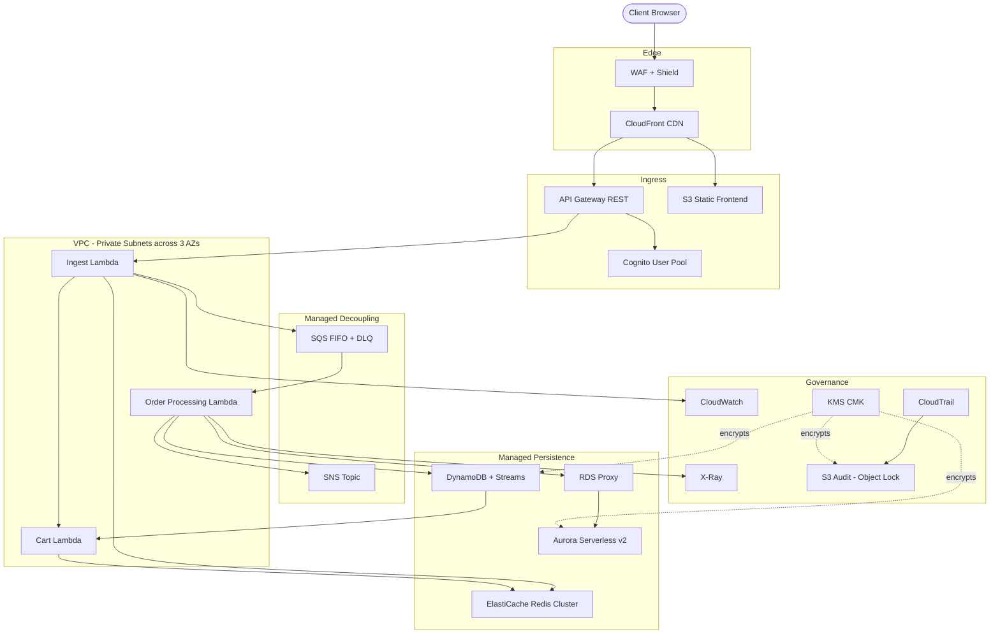
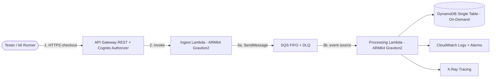

# ChopeE Project Setup Design

**Path:** `docs/superpowers/specs/2026-09-24-chopee-project-setup-design.md`
**Date:** 2026-09-24
**Status:** Approved for implementation
**Project:** ChopeE — Online Shopping System (Singapore + ASEAN demo)
**Region:** `ap-southeast-1` (Singapore) only. No multi-region deployment.

**Goal:** Define the complete architecture, documentation system, and setup for ChopeE as a strictly EPHEMERAL zero-idle-cost serverless demonstration within a total budget limit of USD 80 for active test runs only.

> **Ephemeral Testing Lifecycle (binding):** The Cost-Optimised School Demo in §2.2 is strictly EPHEMERAL — spun up for at most a few hours during active testing or marker evaluation, then immediately torn down via `terraform destroy -auto-approve`. The USD 80 budget covers active test runs only (pay-per-request charges incurred while the stack exists); there is deliberately zero idle burn between runs because nothing remains deployed.

**Architecture:** Dual-track narrative — a theoretical enterprise target (Multi-AZ VPC + Aurora Serverless v2 + ElastiCache) to satisfy Tier 1 rubric ambition, and a cost-optimized deployed demonstration (API Gateway + SQS FIFO + Lambda ARM64 + DynamoDB on-demand single table + VPC Gateway Endpoints) actually provisioned via manual Terraform CLI only.

**Tech Stack:** Terraform (CLI only, no CI/CD), API Gateway REST, SQS FIFO + DLQ, Lambda ARM64 Graviton2 (Python 3.12), DynamoDB on-demand, CloudWatch + X-Ray, Cognito User Pool, S3 (frontend/audit), KMS CMK.

## Global Constraints

- Total cloud spend strictly ≤ USD 80 for active test runs only (hard cap, AWS Budgets alert at USD 1.00 and forecast guardrails). No idle spend: the demo stack exists only for hours at a time.
- Demo is strictly EPHEMERAL: spun up for at most a few hours during testing or marker evaluation, then immediately torn down via `terraform destroy -auto-approve`. Fast-teardown guarantees: S3 buckets must have `force_destroy = true` in demo tfvars to prevent `BucketNotEmpty` errors; no ENI-hanging dependencies (Lambdas outside VPC by default, so no ENI cleanup delay); zero hourly-billed services (NO NAT Gateway, NO Aurora, NO ElastiCache Redis cluster) to ensure zero budget leakage between runs.
- 100% data residency in `ap-southeast-1`; AES-256 at rest (KMS CMK where free-tier viable), TLS 1.3 in transit; PDPA-aligned consent + 7-year audit retention narrative.
- Flash-sale target: 1500 TPS absorb, p95 < 1.5s for checkout mutations (design target; demo validates at reduced synthetic load).
- Manual `terraform plan` / `terraform apply` from operator workstation only — no GitHub Actions / no CI/CD pipelines.
- Zero-idle-cost serverless only in deployed demo — no NAT Gateway (~$32+/mo each), no Aurora, no ElastiCache, no always-on endpoints.
- Docs live in `docs/specs/` (01–05) + `docs/plans/`; `AGENTS.md` + `.agents/` govern the vibe-coding workflow; zero reference to any external Group 1 report; all legacy `.docx`/`.pdf` removed.

---

## 1. Business Context & Strategic Goals

### 1.1 Operating context

ChopeE is an omnichannel online shopping system headquartered in Singapore, serving urban consumers aged 18–45. Traffic is flash-sale driven (9.9, 11.11, payday sales).

- **Geography:** Singapore 80% + ASEAN 20% (MY/TH/HK spillover). All serving and storage stays in `ap-southeast-1`; ASEAN users are served cross-border from Singapore — no data replication outside the region.
- **Boundary:** Customer identity (Cognito), catalog discovery, cart lifecycle, order processing, compliance logging. Out of scope (tokenized interfaces only): payment gateway settlement, logistics fulfilment.
- **Peak profile:** Bursty checkout writes, hot catalog reads, anonymous browsing → authenticated purchase conversion.

### 1.2 Three strategic goals (design drivers)

| # | Goal | Measurable target | Design consequence |
|---|------|-------------------|--------------------|
| G1 | Elastic flash-sale throughput | Absorb 1500 TPS bursts; p95 < 1.5s on checkout mutations; zero dropped valid requests | Async ingest (202 on enqueue), SQS FIFO buffering per-customer ordering, controlled-concurrency downstream workers, conditional inventory writes, hot-read caching narrative |
| G2 | Consumer data sovereignty & PDPA compliance | 100% data in `ap-southeast-1`; AES-256 at rest; explicit consent tracking; immutable 7-year audit trail | KMS envelope encryption, Cognito consent attributes, CloudTrail → S3 Object Lock (Governance Mode) audit bucket, no cross-region copies |
| G3 | Capital efficiency & serverless economics, ≤ USD 80 total | Zero idle cost; pay-per-request only for demo | DynamoDB on-demand, Lambda ARM64 Graviton2 (~20% cheaper), SQS FIFO, API Gateway; exclude NAT Gateway / Aurora / ElastiCache from deployed demo; manual Terraform CLI to avoid pipeline-runner costs |

G3 is a hard constraint, not an aspiration: any resource with hourly charge is excluded from the deployed demo and retained only in the theoretical narrative (Section 2).

---

## 2. Architecture & Service Boundaries

### 2.1 Theoretical Enterprise Architecture (rubric ambition, NOT deployed)

Purpose: show the team can reason at enterprise scale. Presented in proposal slides and `docs/specs/` as the target state.

**Diagram A — Theoretical Enterprise Production Architecture (Multi-AZ, ap-southeast-1a/b/c):**

Services: Multi-AZ VPC, API Gateway, SQS FIFO, Lambda, DynamoDB + Aurora Serverless v2 via RDS Proxy, ElastiCache Redis, CloudWatch/X-Ray/CloudTrail, WAF/CloudFront/S3/KMS/SNS/Cognito.

Why each exists (linkage): CloudFront/WAF shed edge abuse; API Gateway validates schema + JWT; SQS absorbs bursts and preserves per-customer FIFO; Lambda scales without idle servers; Redis offloads hot reads; DynamoDB gives conditional-write inventory safety; Aurora gives ACID ledger; RDS Proxy survives Lambda connection storms; CloudWatch/X-Ray/Trail give the audit/observability story; KMS + Object Lock give the PDPA story. RPO ≤ 5 min (PITR + Aurora WAL), RTO ≤ 15 min (pilot-light to ap-southeast-2 narrative).

### 2.2 Cost-Optimized Ephemeral Demonstration Architecture (what Terraform actually creates)

Purpose: everything a marker can `terraform apply` and demolish for cents, with zero idle burn. Strictly EPHEMERAL: live for at most a few hours per test run or marker evaluation, then `terraform destroy -auto-approve` immediately after.

**Diagram B — Cost-Optimised Ephemeral Demonstration Architecture (sequential 1-2-3 data flow):**

Flow: 1) tester/k6 sends authenticated checkout requests; 2) API Gateway validates Cognito JWT and invokes Ingest Lambda, which returns `202 ACCEPTED`; 3) Ingest enqueues to SQS FIFO, Processing Lambda drains the queue and commits to DynamoDB, emitting CloudWatch/X-Ray telemetry.

Explicitly excluded from deployed demo: NAT Gateway (each ~$32/mo — would consume the USD 80 budget alone), Aurora Serverless v2 + RDS Proxy, ElastiCache Redis, CloudFront/WAF (optional narrative only), cross-region pilot-light, provisioned throughput.

### 2.3 Contrast table (the single slide markers remember)

| Dimension | Theoretical Enterprise | Deployed Demo (Terraform) | Rationale |
|-----------|------------------------|---------------------------|-----------|
| Network | Multi-AZ VPC, private subnets, VPC Links, Interface Endpoints | No VPC or minimal VPC + Gateway Endpoints only; never NAT Gateway | Gateway Endpoints are free; NAT Gateways are hourly-billed |
| Ingest | API GW + WAF + CloudFront | API Gateway REST only | Edge stack is narrative; demo needs only JWT-validated ingest |
| Buffering | SQS FIFO + DLQ | Same SQS FIFO + DLQ | FIFO + dedup is the cheapest elasticity story; keep it |
| Compute | Lambda (x86 narrative) | Lambda ARM64 Graviton2, Python 3.12, reserved concurrency | ~20% cheaper per ms; ARM is rubric-friendly efficiency evidence |
| Operational store | DynamoDB (multi-table narrative) | DynamoDB on-demand **single table** (`pk`/`sk` + 1–2 GSIs, TTL on guest carts) | One table = minimal RCU/WCU sprawl, simplest IaC |
| Ledger | Aurora Serverless v2 via RDS Proxy | DynamoDB TransactWriteItems ledger entries (demo) | Aurora idle/min-ACU cost breaks USD 80; DynamoDB pay-per-write does not |
| Cache | ElastiCache Redis | None (TTL + short API-GW caching narrative) | Redis hourly cost excluded |
| Observability | CloudWatch + X-Ray + CloudTrail → S3 Object Lock | Same (all pay-per-ingest, near-free at demo volume) | Keep full observability — it is cheap and rubric-scored |
| Data protection | KMS CMK everywhere | KMS AWS-managed default + CMK only where free; consent attributes in table | Same PDPA narrative, no CMK monthly fees |
| Delivery | GitHub Actions CI/CD | **Manual Terraform CLI only** (`terraform init/plan/apply/destroy`); S3 + DynamoDB remote state/lock; console changes blocked by IAM guardrail narrative | No runner minutes, no pipeline secrets, full audit via state + plan files |

### 2.4 Service boundaries (deployed demo)

1. **Identity (Cognito):** signup/signin, JWT, consent-timestamp custom attributes. No custom auth code.
2. **Ingest (API GW + Ingest Lambda):** validate schema, require `Idempotency-Key: <uuidv4>`, `PutMessage` to SQS FIFO, return `202 {orderId, status: ACCEPTED}` in < 200 ms. Never touches inventory synchronously.
3. **Buffer (SQS FIFO + DLQ):** `MessageGroupId = customerId`, content-based dedup on idempotency key, `VisibilityTimeout` ≥ 6× Lambda timeout, DLQ `maxReceiveCount=3` + CloudWatch alarm.
4. **Process (Processing Lambda):** batch source mapping, DynamoDB conditional decrement (`stock >= qty`), `TransactWriteItems` for cart-merge/order-commit, idempotency guard (`attribute_not_exists(idemKey)`), SNS fan-out on success.
5. **Store (DynamoDB single table):** entity prefixes (`USER#`, `CART#`, `GUEST#`, `INV#`, `ORDER#`, `IDEM#`, `CONSENT#`), TTL on `GUEST#` (24 h), GSI on order-by-customer, PITR enabled (cents at demo scale).
6. **Observe (CloudWatch/X-Ray):** structured JSON logs with `traceId/orderId/idemKey`, alarms on 5xx > 2%/5min, `ApproximateAgeOfOldestMessage` > 60 s, Lambda errors/throttles, DynamoDB throttles.

### 2.5 Manual Terraform CLI execution (no CI/CD)

- Operator runs `terraform fmt -check`, `terraform init`, `terraform validate`, `terraform plan -out=tfplan`, `terraform apply tfplan`, `terraform destroy` from an allowlisted IAM role. State in S3 + DynamoDB lock table, both in `ap-southeast-1`.
- Repo layout: `terraform/{versions.tf,variables.tf,main.tf,modules/{api,cognito,queues,compute,tables,observe}/,envs/demo.tfvars}`. No `.github/workflows/` for infra. This is deliberate and must be stated in the report — automation absence is a cost control, not a gap.

---

## 3. IS458 Course Rubric Alignment (Tier 1 — 7 criteria)

Map every criterion to a concrete artifact. No criterion without evidence.

| # | Criterion | What markers look for | ChopeE evidence | Artifact |
|---|-----------|----------------------|-----------------|----------|
| 1 | Feasibility | Scope fits time/budget/skills; risks named | Flash-sale scope cut to 5 bounded contexts; USD 80 cap enforced by zero-idle-cost + manual CLI; 6-role split; risks (cold start, SQS poison, oversell) with mitigations | `docs/specs/01-scope-feasibility.md` |
| 2 | Resource Justification | Each resource earns its place on cost/performance | Per-resource keep/kill table (Section 2.3); ARM64 %, on-demand vs provisioned, Gateway Endpoint vs NAT math | `docs/specs/02-architecture.md` § justification |
| 3 | Resource Linkage | Resources connect into a coherent flow | Ingest→buffer→process→store→notify trace with IAM least-privilege per hop; JWT→FIFO-group→conditional-write→SNS chain | `docs/specs/02-architecture.md` diagrams + IAM matrix |
| 4 | Design & Implementation | IaC actually provisions; code runs end-to-end | Modular Terraform + Lambda handlers + single-table schema + spikes 1–3 validated; `plan/apply/destroy` reproducible | `terraform/` + `src/` + `docs/specs/03-*` + Section 5 spikes |
| 5 | Monitoring & Alerts | Health visible; thresholds actionable | 4 alarms (5xx, queue age, Lambda errors/throttles, DB throttles) + X-Ray trace + structured logs + SNS to on-call | `docs/specs/04-operations.md` + `terraform/modules/observe/` |
| 6 | Scalability & Availability | Burst + failure handled | SQS absorbs 1500 TPS narrative; reserved concurrency; FIFO per-customer order; DLQ; Multi-AZ managed services; conditional-write no-oversell proof | `docs/specs/02-architecture.md` + Spike 1 & 3 reports |
| 7 | Management Approach | Roles, phases, cadence, budget control | 6 roles (architect, DevOps/IaC, security, backend, data, SRE), 5 phases, AWS Budget USD 1.00 early-warning under USD 80 cap, manual-apply gate | `docs/specs/05-management.md` |

Tier 1 bar: ambition (enterprise target) + proof (demo actually runs) + thrift (USD 80). The dual-track narrative in Section 2 exists specifically to hit all three at once.

---

## 4. Documentation System

### 4.1 Vibe-coding workflow (bootstrap)

Create at repo root on setup:

- `AGENTS.md` — root operating contract: stack, region, budget cap, manual-Terraform-only rule, doc locations, Definition of Done, forbidden patterns (no NAT, no Aurora in demo, no Group 1 references).
- `.agents/` — reusable agent playbooks (e.g. `terraform-apply.md`, `spike-runner.md`, `spec-author.md`) so any contributor/LLM agent works the same way.
- `docs/specs/` — durable design truth (numbered 01–05, see 4.2).
- `docs/plans/` — dated execution plans (`YYYY-MM-DD-<topic>.md`); this file's follow-on plans live there.
- `docs/superpowers/specs/` — this design doc (setup decision record). Future setup-level decisions append here; product truth stays in `docs/specs/`.

### 4.2 Markdown migration (01–05) + legacy purge

Migrate the intent (never the prose) of the legacy `proposal.md` + scattered briefs into clean specs:

- `docs/specs/01-scope-feasibility.md` — geography, use cases, G1–G3, feasibility, risks.
- `docs/specs/02-architecture.md` — dual-track architecture, Section 2 tables/diagrams, IAM matrix, single-table schema.
- `docs/specs/03-data-cart-orders.md` — cart migration, idempotency, inventory transactions, DynamoDB key design.
- `docs/specs/04-operations.md` — alarms, logs, X-Ray, budgets, DR narrative, runbooks.
- `docs/specs/05-management.md` — roles, 5 phases, cadence, budget governance, presentation plan.

Then **delete every `.docx` and `.pdf`** in the repo (`Project Scope.docx`, `Project Specification.docx`, `Timeline_Deadline_Admin.docx`, all three PDFs). Verify with a glob for `**/*.{docx,pdf}` returning zero hits. **Zero reference to any external Group 1 report** — no filename, no citation, no "as Group 1 did". The design must stand on its own; any lingering reference fails review.

### 4.3 Doc hygiene rules

- Specs are normative; plans are transient. Never duplicate normative content into a plan — link it.
- Every diagram as text (Mermaid) so diffs review cleanly.
- Every cost claim names the pricing lever (ARM64, on-demand, no NAT) and the cap (USD 80).

---

## 5. Spikes & Validation Plan

Open-source reference: adapt proven serverless cart/checkout patterns from `aws-samples/aws-serverless-shopping-cart` into clean, minimal Terraform + Python — borrow the pattern (FIFO ingest, transactional merge, conditional decrement), never vendor the repo. Reimplement in our module layout with our naming.

### Spike 1 — SQS decoupling & idempotency

- **Question:** Does FIFO buffering + idempotency key survive burst + duplicate delivery without double-charge?
- **Build:** API GW → Ingest Lambda (validate + `SendMessage` with `MessageDeduplicationId=<idemKey>`, `MessageGroupId=<customerId>`) → SQS FIFO → Processing Lambda (guard `attribute_not_exists(IDEM#<key>)`). DLQ + age alarm.
- **Validate:** Send N duplicates of one key + burst batch; assert exactly-one order commit, `202` in < 200 ms at demo volume, DLQ receives only poison messages. Record p50/p95 at demo load; extrapolate to 1500 TPS narrative honestly.
- **Exit:** Exactly-once commit proof + latency table in `docs/plans/` spike report.

### Spike 2 — Anonymous-to-authenticated cart migration (DynamoDB transactions)

- **Question:** Does guest→user merge lose nothing under race (login while guest cart writes)?
- **Build:** Guest cart (`GUEST#<uuid>`, TTL 24 h) + user cart (`CART#<userId>`); Cognito post-auth trigger → merge Lambda: read both, re-price from catalog, `TransactWriteItems` (put merged lines + delete guest + write consent/audit), retry on `TransactionCanceledException`.
- **Validate:** Concurrent guest-add + login sequences; assert merged quantities equal sum, pricing refreshed, guest key deleted, TTL honored. Chaos: double-login, empty guest, empty user.
- **Exit:** Merge matrix (all 4 empty/non-empty combos green) + transaction snippet in `docs/specs/03-*`.

### Spike 3 — Concurrency & inventory conditional decrements under load

- **Question:** Does `stock >= qty` hold with concurrent buyers and no oversell?
- **Build:** Inventory item (`INV#<sku>` with `stock` number); Processing Lambda `UpdateItem ConditionExpression="stock >= :qty"`; contention fallback: FIFO throttle + limited retry with jitter; throttles alarm.
- **Validate:** Synthetic burst oversubscribing stock (e.g. 10 units, 50 buyers); assert final `stock >= 0`, successful commits ≤ initial stock, losers get clean `409 CONFLICT` → SNS/UX path. Record throttle count + X-Ray segments.
- **Exit:** No-oversell proof table + conditional-expression snippet + scaling note (partition hot SKUs if needed).

Each spike: time-boxed, demo-volume only (cents), report in `docs/plans/YYYY-MM-DD-spikeN-<name>.md` with question/build/validate/exit. No spike provisions NAT/Aurora/Redis.

---

## 6. Setup Roadmap (what happens next, in order)

1. **Bootstrap workflow:** create `AGENTS.md`, `.agents/`, `docs/specs/`, `docs/plans/`; commit.
2. **Migrate + purge:** write `docs/specs/01–05`, delete all `.docx`/`.pdf`, verify zero hits + zero "Group 1" strings; commit.
3. **Terraform skeleton:** `terraform/` modules per Section 2.4 + `envs/demo.tfvars` (region `ap-southeast-1`, ARM64, on-demand); `init/validate/plan` green with no apply yet; commit.
4. **Spikes 1→2→3:** one plan file + one report each under `docs/plans/`; only cheapest resources live during runs; `destroy` after each; commit per spike.
5. **Demo harden:** alarms, budgets (USD 1.00 alert), runbooks, presentation slice; final `apply` rehearsal + `destroy`; commit.

Total cloud cost across all steps must remain a small fraction of the USD 80 cap — if any step threatens it, cut scope, never raise the cap.

---

## Appendix A — Budget Guardrails (USD 80 hard cap)

- AWS Budgets: actual-spend alert at USD 1.00 + forecast alert; owner stops work on breach.
- Billing levers: on-demand only, ARM64 Lambdas, Gateway Endpoints (free) instead of NAT, S3 lifecycle off demo buckets, PITR only on the single demo table, X-Ray sampling at demo rate.
- Forbidden in demo (cost): NAT Gateway, Aurora/RDS Proxy, ElastiCache, CloudFront continuous use, cross-region replication, provisioned concurrency at scale.

## Appendix B — Explicit Non-Goals

- No CI/CD pipelines for infra (manual CLI only). No multi-region deployment. No payment/logistics integration beyond tokenized stubs. No Group 1 report lineage in any form.
